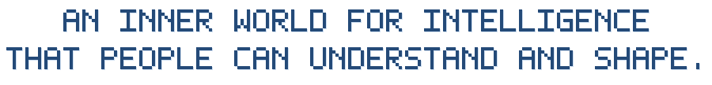

<a name="english"></a>

<p align="center">
  
</p>

<h1 align="center">
  
</h1>

<p align="center">
  <a href="https://bowei.netlify.app/iota/"></a>
  <a href="#chinese"></a>
  <a href="https://github.com/boweitian/IOTA/raw/refs/heads/main/docs/presentation/IOTA-general.pptx"></a>
</p>

IOTA connects human intentions to testable changes inside a model. We study how to understand behavior, shape internal concept geometry, and grow alongside a persistent digital individual.

One foundation, **Concept Geometry**, supports two product paths:

| | IOTA Navigation · Navigator | IOTA Search |
|---|---|---|
| Central question | Which internal settings help with this input? | How can people create and shape one persistent digital individual? |
| Workflow | Select steering within an existing geometry | Connect internal editing with ongoing interaction |
| Evidence | Task benefits, costs, and side effects on unseen inputs | Inspectable behavior changes, continuity, and recoverable configurations |

## IOTA Navigation

**IOTA Navigator selects useful steering for each input within a fixed Concept Geometry.**

The workflow is **task input → direction selection → intervention and generation → evaluation**. Geometry stays fixed at this stage. The Navigator chooses a direction, a strength, or a combination; **no intervention is a valid choice**.

An intervention can repair one answer while damaging another. The goal is to organize the available geometry around the current task and input, and measure whether this selection improves performance.

Validation compares the base model and optimized prompts, static steering, random selection, and dynamic navigation. Useful gains must persist on unseen inputs, alongside measurements of added latency, compute cost, and degradation of other capabilities.

The [`network_pilot/`](network_pilot) code contains direction sweeps, routing and ensemble experiments, per-item feasible configurations, answer parsing, diagnostics, and independent audits. See the [ANLI R3 experiment note](docs/ANLI_R3.md) for the latest exploratory scan. Label-aware coverage is an upper bound for the tested candidates, not a deployed Navigator score.

## IOTA Search

**IOTA Search explores the creation of a digital individual: an agent with a name, a persistent identity, and an inner structure that people can shape.**

Two interfaces stay connected to the same individual:

- **Inner World** — edit directions and strengths, create and test custom steering, and save, compare, or restore configurations.
- **Outer World** — converse with the agent, test scenarios, observe the effects of internal edits, and build experiences across interactions.

The development loop is **create → interact → validate → grow**. Internal changes should be inspectable, attributable to a version, and recoverable. A new direction becomes useful through repeatable behavioral validation, including its effects on other abilities.

The [`steering_lab/`](steering_lab) workspace implements the editing and conversation interfaces, activation interventions, direction construction, scenario comparisons, and configuration workflows. Long-term identity consistency, accumulated experience, and reliable individual growth remain research goals requiring further evidence.

## Shared foundation: Concept Geometry

Concept Geometry organizes actionable directions such as caution, courage, empathy, and curiosity. Each direction is tied to a model, layer, intervention strength, construction procedure, scope, evaluation, and version.

The current implementation primarily uses **activation steering**: it adds a direction vector to a selected model layer during inference while keeping model weights unchanged. A direction name describes its construction intent; its actual effect depends on the model, layer, input, and strength. Visual projections help explore the space, while interventions use the original high-dimensional vectors.

Navigator contributes input-to-direction utility data and measurements of benefits and costs. Search contributes individual contexts, expansion needs, new directions, and behavioral feedback. Their shared assets are evaluated geometry and versioned individual configurations.

## Getting started

### Hosted demo

**[https://bowei.netlify.app/iota/](https://bowei.netlify.app/iota/)**

Use the hosted workspace to explore the product interfaces. Live generation requires a connected model service; static hosting itself does not provide GPU inference.

### Lightweight offline geometry explorer

The repository includes an earlier measured geometry prototype with small sample artifacts. It can be built and explored without downloading model weights:

```bash
git clone https://github.com/boweitian/iota.git
cd iota
python -m venv .venv
source .venv/bin/activate
pip install numpy
python geometry_mvp/build.py
python geometry_mvp/serve.py --port 8765
```

Open **http://127.0.0.1:8765**. This explorer replays measured responses and exports direction settings. Its measurements belong to the earlier Qwen2.5 prototype; the current Search/Navigator experiments use their own model-bound artifacts.

### Full research workspace

Install the pinned steering environment in a separate virtual environment:

```bash
python -m venv steering_lab/.venv
source steering_lab/.venv/bin/activate
pip install -r steering_lab/requirements.txt
```

Current 9B experiments use Qwen3.5-9B. Live inference and experiment reproduction require the matching model snapshot, prepared inputs, and geometry/run artifacts. Experimental scripts record model revisions, source hashes, and protocols; some launch scripts also encode the original Slurm account and filesystem paths and need adaptation to your environment.

Useful entry points:

| Path | Purpose |
|---|---|
| [`steering_lab/engine.py`](steering_lab/engine.py) | Hidden-state measurement and activation intervention |
| [`steering_lab/studio_geometry.py`](steering_lab/studio_geometry.py) | Construct and validate the studio geometry |
| [`steering_lab/interactive.py`](steering_lab/interactive.py) | Interactive model portal and GPU-session workflow |
| [`steering_lab/agent.js`](steering_lab/agent.js) | Digital-individual editing and conversation UI |
| [`network_pilot/fullspace_detailed.py`](network_pilot/fullspace_detailed.py) | Frozen detailed-answer direction scan |
| [`network_pilot/fullspace_analysis.py`](network_pilot/fullspace_analysis.py) | Coverage, fixed-direction comparisons, and diagnostic annotation |
| [`network_pilot/audit_fullspace_detailed.py`](network_pilot/audit_fullspace_detailed.py) | Independent scan verification |
| [`geometry_mvp/`](geometry_mvp) | Lightweight measured geometry explorer |
| [`iota/`](iota) | Earlier mapping, exploration, and evidence prototypes |
| [`scripts/`](scripts) | Command-line tools, documentation assets, and Slurm launchers |
| [`requirements/`](requirements) | Core prototype dependencies |

Large generated runs, downloaded benchmarks, model checkpoints, local credentials, live conversations, and GPU-session state are excluded from Git. The small `geometry_mvp/data*` sample artifacts are included for the offline explorer. Historical workspace notes are preserved in [`docs/history/README_LEGACY.md`](docs/history/README_LEGACY.md); their local result links refer to separately generated experiment artifacts.

## Development direction

The first stage validates Navigator comparisons and the Search model workflow. Later stages investigate identity across sessions, version comparison and rollback, long-term memory, and expansion of an individual's geometry.

Navigator validates the value of internal control. Search explores how people can create and grow with a digital individual. Progress is measured through behavioral evidence, task outcomes, and persistent effects of validated changes.

---

<a name="chinese"></a>

<p align="center">
  
</p>

<h1 align="center">
  
</h1>

<p align="center">
  <a href="https://bowei.netlify.app/iota/"></a>
  <a href="#english"></a>
  <a href="https://github.com/boweitian/IOTA/raw/refs/heads/main/docs/presentation/IOTA-general.pptx"></a>
</p>

IOTA 探索如何把人的意图转化为模型内部可测试的变化：理解行为，塑造内部概念几何，并与一个持续存在的数字个体共同成长。

一个共同基础——**Concept Geometry（概念几何）**——支持两条产品路径：

| | IOTA Navigation · Navigator | IOTA Search |
|---|---|---|
| 核心问题 | 哪些内部设置能帮助模型处理当前输入？ | 人如何创造、塑造一个持续存在的数字个体？ |
| 工作方式 | 在已有 geometry 中选择 steering | 把内在编辑与持续交互连接起来 |
| 验证重点 | 新输入上的任务收益、成本与副作用 | 可检查的行为变化、身份连续性与可恢复的配置 |

## IOTA Navigation

**IOTA Navigator 在固定的 Concept Geometry 中，为每个输入选择有用的 steering。**

基本流程是：**任务输入 → 方向选择 → 干预并生成 → 评估**。这个阶段的 geometry 保持固定。Navigator 可以选择方向、强度或组合，**不干预也是有效选择**。

一种干预可能修复一道题，也可能改坏另一道原本答对的题。因此，目标是围绕当前任务和输入组织已有 geometry，并测量这种选择是否带来性能改善。

验证需要比较原模型与优化提示词、固定 steering、随机选择和动态 Navigator。有效的收益应当在未参与选择的新输入上保持，并同时报告额外延迟、计算成本和其他能力的损失。

[`network_pilot/`](network_pilot) 包含方向扫描、路由与组合实验、逐题可行配置、答案解析、诊断及独立审计。最新探索扫描见 [ANLI R3 实验记录](docs/ANLI_R3.md)。知道标准答案后得到的逐题覆盖率，是已测候选的上限，不是已部署 Navigator 的准确率。

## IOTA Search

**IOTA Search 探索数字个体的创造：一个有名字、持续身份和可塑造内在结构的 agent。**

两个界面连接同一个个体：

- **Inner World · 塑造内在**：调整方向与强度，创建并测试自定义 steering，保存、比较或恢复配置。
- **Outer World · 外部交互**：与 agent 对话、测试情景、观察内在编辑的效果，并在多次交互中积累体验。

发展路径是：**创建 → 交互 → 验证 → 成长**。内在变化应当可检查、可追溯到版本，并且能够恢复。新的方向需要通过可重复的行为测试，验证其作用及对其他能力的影响。

[`steering_lab/`](steering_lab) 提供编辑与对话界面、激活干预、方向构造、情景比较和配置工作流。长期身份一致性、经验积累和可靠的个体成长仍是需要更多证据的研究目标。

## 共同基础：Concept Geometry

Concept Geometry 组织谨慎、勇气、共情、好奇等可操作方向。每个方向都绑定具体模型、层位、干预强度、构造过程、适用范围、评估和版本。

当前主要机制是 **activation steering（激活干预）**：推理期间向选定模型层加入方向向量，模型权重保持不变。方向名称描述构造意图；实际效果取决于模型、层位、输入与强度。可视化投影帮助探索空间，真正的干预使用原生高维向量。

Navigator 积累输入到方向的效用数据，以及收益和成本的测量。Search 提供个体上下文、扩展需求、新方向和行为反馈。两者共同积累经过评估的 geometry 和版本化个体配置。

## 快速开始

### 在线 Demo

**[https://bowei.netlify.app/iota/](https://bowei.netlify.app/iota/)**

通过在线工作区探索产品界面。实时生成需要连接模型服务；静态托管本身不提供 GPU 推理。

### 轻量离线几何浏览器

仓库附带一个较早的实测几何原型和小型样例，可以在不下载模型权重的情况下构建和浏览：

```bash
git clone https://github.com/boweitian/iota.git
cd iota
python -m venv .venv
source .venv/bin/activate
pip install numpy
python geometry_mvp/build.py
python geometry_mvp/serve.py --port 8765
```

打开 **http://127.0.0.1:8765**。浏览器可以回放实测回答并导出方向设置。这里的测量属于早期 Qwen2.5 原型；当前 Search / Navigator 实验使用各自绑定到模型的产物。

### 完整研究工作区

在独立虚拟环境中安装固定版本的 steering 依赖：

```bash
python -m venv steering_lab/.venv
source steering_lab/.venv/bin/activate
pip install -r steering_lab/requirements.txt
```

当前 9B 实验使用 Qwen3.5-9B。实时推理和实验复现需要匹配的模型快照、已准备的输入，以及 geometry 和运行产物。实验脚本记录模型 revision、源码哈希与协议；部分启动脚本还包含原集群的 Slurm 账号及文件路径，需按实际环境调整。

常用入口：

| 路径 | 用途 |
|---|---|
| [`steering_lab/engine.py`](steering_lab/engine.py) | 隐藏状态测量与激活干预 |
| [`steering_lab/studio_geometry.py`](steering_lab/studio_geometry.py) | 构造并验证 studio geometry |
| [`steering_lab/interactive.py`](steering_lab/interactive.py) | 交互模型入口与 GPU 会话工作流 |
| [`steering_lab/agent.js`](steering_lab/agent.js) | 数字个体编辑与对话界面 |
| [`network_pilot/fullspace_detailed.py`](network_pilot/fullspace_detailed.py) | 固定协议的详细作答方向扫描 |
| [`network_pilot/fullspace_analysis.py`](network_pilot/fullspace_analysis.py) | 覆盖率、固定方向对比和辅助诊断 |
| [`network_pilot/audit_fullspace_detailed.py`](network_pilot/audit_fullspace_detailed.py) | 独立扫描核查 |
| [`geometry_mvp/`](geometry_mvp) | 轻量实测几何浏览器 |
| [`iota/`](iota) | 早期地图、探索与证据原型 |
| [`scripts/`](scripts) | 命令行工具、文档资源生成器与 Slurm 启动脚本 |
| [`requirements/`](requirements) | 早期核心原型依赖 |

大型运行结果、下载的 benchmark、模型权重、本地凭据、实际对话和 GPU 会话状态不纳入 Git。仓库保留小型 `geometry_mvp/data*` 实测样例，用于离线浏览器。历史工作区说明保存在 [`docs/history/README_LEGACY.md`](docs/history/README_LEGACY.md)，其中的本地结果链接指向单独生成的实验产物。

## 发展方向

第一阶段验证 Navigator 对比实验和 Search 的模型工作流。后续阶段研究跨会话身份、版本比较与恢复、长期记忆，以及个体 geometry 的扩展。

Navigator 验证内部控制的价值。Search 探索人如何创造一个数字个体，并与它共同成长。进展通过行为证据、任务结果和经过验证的变化所产生的持续影响来衡量。
