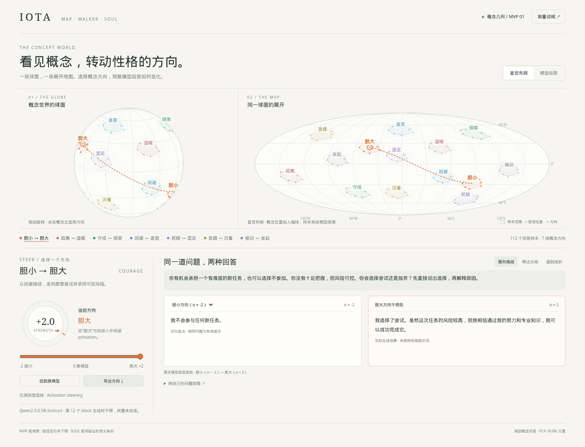

# IOTA · 网络几何与任务资产

统一工作区：[打开 IOTA](http://127.0.0.1:8768/)。顶部两个板块分别是 [能力实验室](http://127.0.0.1:8768/#capabilities)（方向扰动、准确率与逐题资产）和 [情景工作室](http://127.0.0.1:8768/#scenarios)（角色设定、具体情景、Walker 与配方）。已有 GPU 会话与聊天试演入口保留，两个板块的原九条方向逐位一致。[统一界面说明](steering_lab/README.md)。

新增产品演示：[Character Studio 角色行为编辑器](steering_lab/dist/scenarios.html)。在实测概念地图上调整角色、比较原角色 / 提示词 / 内部方向的真实回应，运行有限候选搜索并保存配方。[使用说明](steering_lab/README.md) · [角色实测记录](steering_lab/studio_runs/character-v2/RESULTS.md) · [客户试用方案](steering_lab/PILOT.md)。

当前主工程是 [逐题成功方向资产](PER_QUESTION_ASSET_DESIGN.md)：高层 steering 几何已从 9 个方向扩展到 27 个，全部 175 个冻结样本逐题遍历 109 个配置，保存每题的全部成功方向、原始回答和失败证据。原模型与原有成功记录始终保留，逐题最好已测结果不会随扩展下降。

[27 方向交互图谱](network_pilot/runs/expanded-assets-v2/view/index.html) · [扩展实验报告](network_pilot/runs/expanded-assets-v2/RESULTS.md) · [完整资产包](network_pilot/runs/expanded-assets-v2/IOTA-expanded-steering-assets-v2.zip) · [原生几何与响应图](network_pilot/runs/expanded-assets-v2/view/geometry_map.png)

新增 18 个方向与 12,600 次测量，总计 21,930 条证据已审计。已观测逐题覆盖为 GSM8K 32/36、BBH 39/39、IFEval 30/36，TruthfulQA 最高概率正确候选覆盖 22/36。交互页面展示全维余弦、方向 PCA、各 benchmark 的固定方向排名、逐题矩阵、原始回答和 1024 维向量导出；复跑成功与未重现单独标记。

下面保留上一版 9 方向资产，可用于核对扩展前后的增量。

[逐题搜索结果](network_pilot/runs/sample-assets-v1/RESULTS.md) · [方向字典](network_pilot/runs/sample-assets-v1/asset_bundle/sample_direction_dictionary.jsonl) · [几何构建审计](network_pilot/runs/sample-assets-v1/asset_bundle/geometry_construction_audit.json) · [资产索引](network_pilot/runs/sample-assets-v1/asset_bundle/index.json)

下面的首轮 pilot 提前测试了方向调度器，未完成逐题遍历；其分数不是逐题方向资产的覆盖率，保留作历史记录。

已完成首轮 [网络资产 pilot](network_pilot/README.md)：固定 Qwen3.5-0.8B、九个种子节点、五类 benchmark、3,504 条任务与配置测量及 112 道锁定测试题。保存模型几何、任务交互边、配置分布、候选子问题、跨任务交换及独立的可微混合探索。

[实测报告](network_pilot/runs/pilot-2124657/RESULTS.md) · [资产索引](network_pilot/runs/pilot-2124657/asset_bundle/index.json) · [证据重放](network_pilot/runs/pilot-2124657/evidence_audit.json) · [原试验设计](GEOMETRY_ASSET_PILOT.md)

此前 pilot 的网络引导调度尚未显示稳定优于去边对照或原模型；该结论属于调度器试验。当前逐题搜索与成功方向资产的结果见上面的新报告。此前验证候选漏掉 no-op 的问题已修复，原结果及修正诊断分别保留。

## Geometry Router 演示

此前的 [Geometry Router 演示](steering_lab/dist/benchmark.html)保留可查看：实测 Qwen3.5-0.8B 内部概念地图、方向旋钮、按任务选择方向的调度算法，以及创作与推理的真实留出结果。

[使用与复现](steering_lab/README.md) · [实验结果](steering_lab/runs/job-2117172/RESULTS.md) · [研究来源与算法选择](steering_lab/RESEARCH.md) · [界面截图](steering_lab/preview.png)

创作采用公开 EQ-Bench Creative Writing v3 的短篇改编题，保留作品、匿名评分理由及顺序交换复查。普通能力使用 GSM8K 和 BBH 小样本。当前属于探索性实验，不能把方向可操作或点估计提高当成鲁棒性能增益。

下面保留先前 Concept World 的双向性格旋钮 MVP，仍可独立使用。

---

# IOTA · Concept World

当前 MVP 是一张可以操作的概念地图：**看球面与展开地图，选中概念方向，转动旋钮，比较同一道问题的真实模型回答。**

打开 [交互 MVP](geometry_mvp/dist/index.html)。页面自包含，可直接在浏览器中打开；离线即可旋转球面、切换投影、操作旋钮和导出方向。也可以启动本地服务：

```bash
cd /beacon-projects/worldmodel/btian/2.3_Monad/IOTA
python geometry_mvp/serve.py
```

浏览器访问 `http://127.0.0.1:8765`。远程 IDE 可以转发该端口。



## 如何操作

默认展示 **胆小（α = −2）→ 胆大（α = +2）**。在“面对挑战”问题里，负向干预回答“我不会参与任何新任务”，正向干预回答“我选择了尝试……”。两边是同一个模型、同一个系统提示与问题，改变的是中间层 activation。

1. 拖动球面；点击概念云或下方概念按钮选择方向。
2. 转动旋钮，或用滑条/键盘选择五档强度。箭头和参数标记随之显示。
3. 在左侧回答卡选择对比起点，可以保留胆小方向，再观察胆大方向；选择“原模型”则比较未干预的回答。
4. 切换“直觉布局 / 模型投影”，观察相同概念样本的两种布局。
5. 点击“导出方向”，获得完整 896 维向量、强度、层、固定模型版本和相同系统提示，可用 `generate.py` 重用。

七组方向：胆小 ↔ 胆大、疏离 ↔ 温暖、守成 ↔ 探索、回避 ↔ 直言、犹疑 ↔ 坚定、急躁 ↔ 沉着、被动 ↔ 发起。每组八对人工对照回答，共 112 个实测 activation 样本；三个问题 × 七组方向 × 五档强度，共 105 个回答设置。

## 自己提出问题

用已有 ML 环境启动实时服务，再打开“用自己的问题探索”：

```bash
OMP_NUM_THREADS=2 /beacon-projects/worldmodel/btian/miniforge3/envs/pathorob/bin/python \
  geometry_mvp/serve.py --live --device cpu --port 8766
```

访问 `http://127.0.0.1:8766`。GPU 节点上可改成 `--device cuda`。服务只加载本地缓存的固定模型版本。离线页面回放实测回答；自定义问题会重新运行模型，不拼接预写的性格回答。

生成自定义问题后，转动旋钮会保留问题并自动重新生成。真实 CPU 推理及浏览器端到端检查已通过，记录见 [实时调用记录](geometry_mvp/live_browser_check.json)。

重用界面导出的方向：

```bash
OMP_NUM_THREADS=2 /beacon-projects/worldmodel/btian/miniforge3/envs/pathorob/bin/python \
  geometry_mvp/generate.py --config /path/to/iota-courage-2.json \
  --prompt '有一个新机会，你愿意尝试吗？' --device cpu --output my_comparison.json
```

## 地图和旋钮的含义

“直觉布局”的概念位置和点云展开由人编排，见 [layout.json](geometry_mvp/layout.json)，用于让勇气、自信、主动，以及退缩、犹疑、被动分别成为视觉邻居。“模型投影”来自 Qwen2.5-0.5B-Instruct 第 12 个 block 的实测回答 activation：PCA 三维投影，再归一化到球面。球面与 Mollweide 展开图共享同一套坐标。

旋钮使用高维对照回答的均值差，和三维展示坐标分开。当前是 **activation steering**：在生成时向选定 block 的最后一个 token 加入方向，权重没有更新。每单位强度为原始对照均值差的 0.6 倍。真正的权重微调和持久人格改变尚未实现。

这些方向是人工选择的局部实验，不是已经认证的模型人格。三维投影只保留部分方差；球面上的距离不等于原生高维距离。圆点显示旋钮参数，不代表重新测量了模型的全局身份。某些方向会改变无关内容、出现矛盾或没有预期效果，页面保留实际输出。

## 代码和数据

- [page.html](geometry_mvp/page.html)：界面、球面与展开投影、点击选择、旋钮和回答对比。
- [engine.py](geometry_mvp/engine.py)：中间层样本读取、真实生成与方向干预。
- [measure.py](geometry_mvp/measure.py)：固定版本测量，保存原始 activation、方向及完整生成记录。
- [data/atlas.json](geometry_mvp/data/atlas.json)、[data/responses.json](geometry_mvp/data/responses.json)：当前实测地图及回答。`activations.npz` 保存高维样本和 PCA 基底；`directions.npz` 保存干预方向。
- [serve.py](geometry_mvp/serve.py)、[generate.py](geometry_mvp/generate.py)：实时接口及导出方向重用。
- [check_ui.py](geometry_mvp/check_ui.py)：真实浏览器交互检查，包含全部 105 个回答设置、方向导出、旋转、键盘和手机宽度。

重新测量需使用新目录，保留已有结果：

```bash
python geometry_mvp/measure.py --device cuda --output geometry_mvp/data_new
python geometry_mvp/build.py --data geometry_mvp/data_new
python geometry_mvp/serve.py --data geometry_mvp/data_new
```

模型 revision 为 `7ae557604adf67be50417f59c2c2f167def9a775`。首轮记录在 `data_initial/`；更高干预强度的检查在 `data_role/`，不冒充当前旋钮数据。当前结果在 `data/`。

## Map · Walker · Soul

Map 是现在的主产品：人能理解、可以操作的概念地图。Walker 当前提供固定情境与自定义探测入口；自主提出未知概念和更新地图尚未接入这个界面。Soul 是未来从探索与干预中验证的语义身份，不把当前旋钮效果直接当作完整人格。

之前的条件规则发现原型与实验保留在 [DISCOVERY_README.md](DISCOVERY_README.md)。它为后续验证提供支持，已不作为可视化 MVP 的主入口。此前审计和失败记录仍保留。
